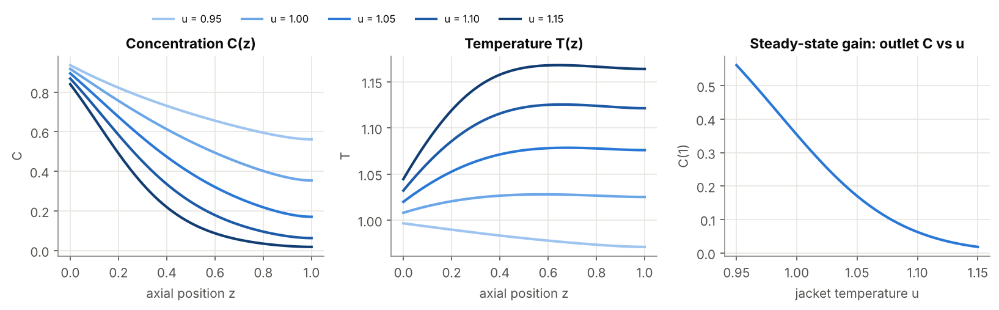
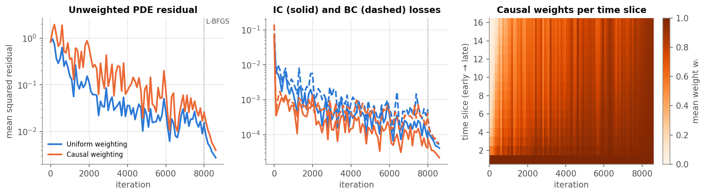
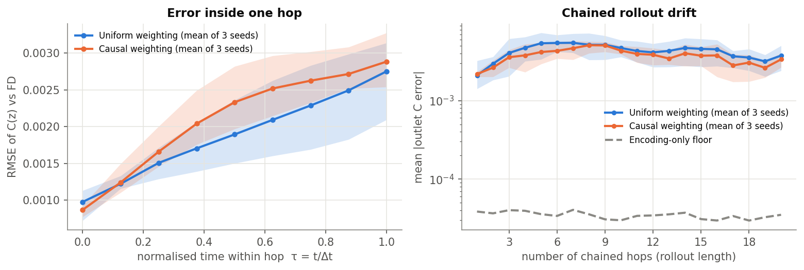
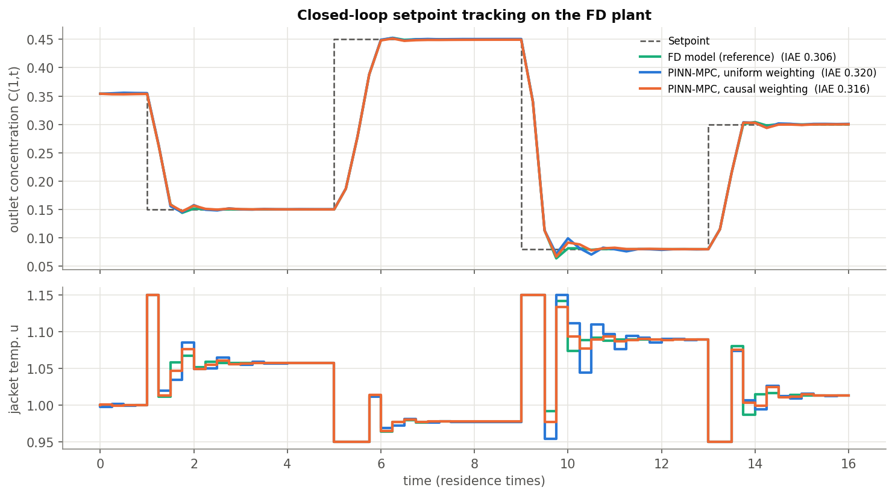

# Causality-Aware Physics-Informed Neural Networks for Model Predictive Control of a Stiff Tubular Reactor

**Revant Sinha (110123088) · Mukund Dinesh Badsewal (110123068)**
Artificial Neural Networks · Instrumentation & Control Engineering · NIT Tiruchirappalli

---

## Abstract

Model predictive control (MPC) of a distributed-parameter plant needs hundreds of model
evaluations per sampling instant, and each evaluation of a PDE model is a full spatial solve.
We replace that solve with a control-oriented physics-informed neural network (PINN) that is
trained from the governing equations alone (no labelled data), maps an encoded initial profile
and a constant jacket temperature to the reactor state over one sampling period, and is chained
to reach an arbitrary prediction horizon. We then test one training change that, to our
knowledge, has not been evaluated inside a closed control loop: causal temporal weighting
(Wang, Sankaran & Perdikaris, 2024), applied per initial condition. Uniform and causal networks
are trained under an identical budget and compared on (i) error inside one hop, (ii) drift over
chained rollouts, and (iii) closed-loop setpoint tracking of outlet concentration on a
finite-difference model of a non-isothermal axial-dispersion reactor with Arrhenius kinetics.

**Results.** With boundary-consistent training initial conditions (v2), the chained PINN predicts
outlet concentration to about 5×10⁻³ after 8 hops, evaluates an 8-hop prediction in 1.0 ms
(35 ms for the finite-difference model), and gives closed-loop tracking within 4–7 % of
perfect-model MPC (IAE 0.318–0.326 vs 0.306) at about 0.04 s per MPC solve instead of 8.15 s.
**Across three seeds, causal weighting does not change accuracy or tracking**: the mean
differences between the arms are smaller than the seed-to-seed spread. The one consistent effect is
lower variance across seeds for the causal arm. A first run (v1) whose training profiles violated
the inlet boundary condition had made causal weighting look worse; the cause and the fix are
described in Section 7.

---

## 1. Problem

MPC solves an optimisation at every sampling instant: it proposes an input sequence, predicts
the plant's response with a model, scores the prediction against the setpoint, and applies only
the first move. For a tubular reactor the model is a pair of coupled, nonlinear PDEs, so every
prediction is a stiff method-of-lines integration on a spatial mesh, and gradients for the
optimiser cost one extra integration per decision variable.

A PINN learns the PDE solution as a smooth function, so a prediction becomes a forward pass and
gradients come from automatic differentiation. Two known issues stand in the way of using one as
an MPC predictor:

1. **Chaining drift.** A control-oriented PINN (PINC, Antonelo et al. 2024) is trained on one short
   window and chained: the end state of hop *k* is the initial state of hop *k+1*, so each hop
   inherits the previous hop's error.
2. **Causality violation.** Gradient descent can shrink the PDE residual at late times before the
   solution near the initial condition is correct (Wang et al. 2024). Inside one hop, a wrong end
   state then seeds the next hop.

Causal training and chained-horizon PINN control were developed independently. This project
combines them and measures whether causal weighting reduces closed-loop tracking error.

## 2. Plant

Dimensionless axial-dispersion reactor, *z* ∈ [0, 1], velocity 1 (time unit = residence time):

```
∂C/∂t = −∂C/∂z + (1/Peₘ) ∂²C/∂z² − k(T) C
∂T/∂t = −∂T/∂z + (1/Peₕ) ∂²T/∂z² + β k(T) C + γ (u − T)
k(T)  = k₀ exp(−E/T),   k₀ = Da·e^E   (so k(1) = Da)
```

Danckwerts boundary conditions: `C − (1/Peₘ) ∂C/∂z = C_in`, `T − (1/Peₕ) ∂T/∂z = T_in` at *z* = 0;
zero gradient at *z* = 1. The manipulated input is the jacket temperature *u* ∈ [0.95, 1.15]; the
controlled output is the outlet concentration *C*(1, *t*).

| Parameter | Value | Meaning |
|---|---|---|
| Peₘ = Peₕ | 10 | axial dispersion (D = α = 0.1) |
| Da | 0.8 | reaction rate at the inlet temperature |
| E | 15 | dimensionless activation energy (exponential temperature sensitivity) |
| β | 0.15 | heat released by the reaction |
| γ | 3 | jacket heat-transfer coefficient |
| C_in, T_in | 1, 1 | feed |


*Figure 1. Steady-state profiles across the input range and the static gain from jacket
temperature to outlet concentration. The gain changes by roughly a factor of eight across the
range, which is why a linear model is not enough.*

**Ground truth.** `src/reactor.py` discretises the PDEs with second-order central differences on
101 nodes (ghost nodes for the Danckwerts conditions) and integrates with an implicit BDF method
and an analytic sparse Jacobian. This model is the "real plant" in closed loop, the reference for
every error reported, and the predictor of the perfect-model MPC baseline. It never produces
training labels.

## 3. Method

### 3.1 From a scalar y₀ to an encoded profile

The Review-1 design fed the network one initial-profile parameter y₀. After one hop the state is
two whole curves, so a scalar cannot carry it into the next hop. Each profile is therefore encoded
by *K* = 6 shifted-Legendre coefficients (least-squares fit on the grid), giving 12 state inputs.
After a hop, the predicted profiles are evaluated on the grid and re-encoded; that loop is what
makes chaining possible. On genuine transient states the truncation error of this encoding is
below 3×10⁻³ in outlet concentration (`K=5` gives 1×10⁻²; `K=8` gives 4×10⁻⁴), and Section 6
reports an *encoding-only floor*: the error a perfect network would still have.

### 3.2 Network

| | |
|---|---|
| Inputs (15) | *z*, τ = *t*/Δ*t*, *u*, 12 profile coefficients (each scaled to about [−1, 1]) |
| Hidden layers | 5 × 64, tanh |
| Outputs | *C*(*z*, *t*), *T*(*z*, *t*) on one hop, Δ*t* = 0.25 |
| Parameters | 17,794 |
| Initialisation | Xavier/Glorot normal |
| Precision | float64 |
| Output form | *C* = *C*₀(*z*) + 0.3·*N_C*, *T* = *T*₀(*z*) + 0.1·*N_T* |

The output form hands the network the initial profile through a skip connection, so its capacity
goes to the change over the hop. The initial condition is still **soft**: the IC loss drives
*N*(*z*, 0) → 0. Both networks use this identical architecture.

### 3.3 Loss and causal weighting

Collocation points are organised as *B* instances (an initial profile and an input) × *M* = 16 time
slices × *P* points per slice. With scaled residuals *r_C*, *r_T* from automatic differentiation,

```
L[b, i]   = mean over points in slice i of instance b of ( r_C² + r_T² )
uniform:  L_pde = mean_{b,i} L[b, i]
causal:   L_pde = mean_{b,i} w[b, i] L[b, i],    w[b, i] = exp( −ε Σ_{j<i} L[b, j] )   (no gradient through w)
total:    L = L_pde + 10 L_ic + 10 L_bc        (Danckwerts inlet + zero-gradient outlet)
```

Wang et al. define the weights for one trajectory. A control-oriented batch holds many
trajectories, so the weights are computed **per instance**: a time slice of one initial
condition switches on when that trajectory's earlier slices are solved, regardless of the rest of
the batch. ε follows the paper's annealing (1 → 10 → 100, advancing when every slice's mean
weight exceeds 0.99).

### 3.4 Where training initial conditions come from (no labelled data)

Instances are drawn from the plant's operating envelope: steady-state profiles of the same PDE
across the input range are blended pairwise and perturbed (75 %), and the rest are uniform in a
box around that envelope widened by 50 %. Transient states visited under random input sequences
fall inside this box 98 % of the time. No transient trajectory and no label enters the loss.

### 3.5 Training

Adam (learning rate 10⁻³, ×0.7 every 1,500 steps) for 8,000 steps with 4,096 fresh collocation
points per step (32 instances × 16 slices × 8), then L-BFGS for 600 steps on a fixed set of 16,384
points. L-BFGS needs a fixed objective, so causal weights are frozen within blocks of 200 steps
and refreshed between blocks. Uniform and causal runs share the seed, sampler, schedule and
budget; only the weighting differs.

## 4. Model predictive control

At each sample (Δ*t* = 0.25), with prediction horizon *N_p* = 8 hops (2 residence times) and
*N_c* = 3 free moves (the last one held):

```
min over u₀..u₂   Σ_{j=1..8} ((ŷ_j + d − r)/0.1)²  +  Σ_j (Δu_j/0.2)²     s.t.  0.95 ≤ u ≤ 1.15
```

ŷ_j is the predicted outlet concentration after hop *j*. The PINN predictor chains hops with
`jax.lax.scan`, so the exact gradient of the cost w.r.t. the inputs comes from `jax.grad` through
the whole chain; the problem is solved by bounded L-BFGS-B with warm starts. The same problem is
solved with the finite-difference model as predictor (finite-difference gradients) as the
perfect-model reference. The full state is assumed measured (an estimator is outside scope). The
optional bias *d* = measured − previously predicted output gives offset-free tracking.

## 5. Experimental protocol

Both arms are trained with seeds 0, 1 and 2 (six networks, v2 encoder) under the budget in
Section 3.5. Each takes 5–6 minutes on an Apple-silicon laptop CPU, two runs in parallel. Values
below are **mean ± sample standard deviation over the three seeds** unless a seed is named.
Open-loop errors use 40 test trajectories × 20 hops produced by the finite-difference model under
random input sequences. Every closed-loop run uses the same 64-step setpoint sequence
(0.354 → 0.15 → 0.45 → 0.08 → 0.30) on the finite-difference plant.

## 6. Results

### 6.1 Training


*Figure 2. Seed 0. Left: unweighted PDE residual; middle: IC and BC losses; right: mean causal
weight per time slice. Unlike v1, every slice switches on during Adam.*

| | Uniform | Causal |
|---|---|---|
| Final unweighted L_pde | (3.1 ± 0.7)×10⁻³ | (4.4 ± 0.7)×10⁻³ |
| Final L_ic | (4.1 ± 0.4)×10⁻⁵ | (2.9 ± 0.9)×10⁻⁵ |
| Final L_bc | (6.5 ± 2.6)×10⁻⁵ | (6.1 ± 0.4)×10⁻⁵ |
| Final minimum causal weight w_min | – | 0.94 ± 0.01 |

With boundary-consistent initial profiles, the causal weights rise from near 0 to about 0.95 on
every slice, against 0.75 on the last slice in v1. They never pass the 0.99 threshold, so ε stays at
1 for the whole run. Under an equal budget, the causal arm ends with a higher *unweighted* PDE
residual: it spends early iterations on early slices, as designed. It ends with a slightly lower
IC loss.

### 6.2 Open-loop accuracy


*Figure 3. Lines: mean over seeds 0–2; bands: min–max over seeds. Left: RMSE of C(z) against
the finite-difference model inside one hop. Right: outlet-concentration error when hops are chained.
Dashed: the error a perfect network would still have from the profile encoding alone.*

| | Uniform | Causal |
|---|---|---|
| Within-hop RMSE of C, τ = 0 | (0.98 ± 0.22)×10⁻³ | (0.87 ± 0.08)×10⁻³ |
| Within-hop RMSE of C, τ = 1 | (2.75 ± 0.57)×10⁻³ | (2.89 ± 0.37)×10⁻³ |
| Outlet-C error after 1 hop | (2.10 ± 0.98)×10⁻³ | (2.18 ± 0.16)×10⁻³ |
| Outlet-C error after 8 hops (MPC horizon) | (5.1 ± 2.0)×10⁻³ | (5.1 ± 0.9)×10⁻³ |
| Outlet-C error after 20 hops | (3.7 ± 1.3)×10⁻³ | (3.4 ± 0.7)×10⁻³ |
| Encoding-only floor | 3.9×10⁻⁵ | 3.9×10⁻⁵ |

The two arms are indistinguishable: every mean difference is smaller than one standard deviation.
Seed 0 alone favoured causal by 20–30 % at τ = 1 and after 8 hops, but seeds 1 and 2 reversed it.
**A single seed would have produced the wrong conclusion here.** The causal arm's spread is 2–6×
smaller on most metrics, which suggests that causal training is more repeatable, though three
seeds are too few to establish that. Chained error does not grow steadily over 20 hops: it rises over
the first ~5 hops, then levels off around 3–5×10⁻³. A likely cause is that the reactor's dynamics
damp perturbations, so earlier hop errors are partly forgotten, but we have not tested this.
Model error is about 100× the encoding floor, so the network, not the encoding, is the
bottleneck.

### 6.3 Closed-loop tracking


*Figure 4. Seed 0, filtered bias correction. Top: outlet concentration; bottom: jacket
temperature. The no-correction version is `results/figures/fig4_closed_loop.png`.*

| Controller | IAE | Mean steady-state offset | Input total variation |
|---|---|---|---|
| FD-MPC (perfect model, reference) | 0.306 | 4×10⁻⁶ | 1.59 |
| PINN-MPC uniform | 0.326 ± 0.005 | (1.3 ± 0.5)×10⁻³ | 1.61 ± 0.14 |
| PINN-MPC causal | 0.322 ± 0.004 | (1.3 ± 0.5)×10⁻³ | 1.60 ± 0.04 |
| PINN-MPC uniform + filtered bias | 0.318 ± 0.004 | (0.51 ± 0.26)×10⁻³ | 1.65 ± 0.19 |
| PINN-MPC causal + filtered bias | 0.318 ± 0.002 | (0.52 ± 0.24)×10⁻³ | 1.62 ± 0.06 |

All six PINN controllers track every setpoint change. Without correction, IAE is 5–7 % above the
perfect-model reference; filtered bias correction brings it to 4 % and cuts the steady-state offset
by about 60 %. Causal and uniform reach the same IAE. The visible difference between controllers is
the transient after the step to 0.08 (t ≈ 10, near the lower input bound), where model error matters
most. In-loop prediction error per step is (2.5 ± 0.8)×10⁻³ for uniform and (2.7 ± 0.2)×10⁻³ for
causal, again with smaller spread for causal.

### 6.4 Computation

| | PINN | Finite differences |
|---|---|---|
| 8-hop prediction (one candidate input sequence) | 1.0 ms | 35 ms |
| Gradient of the MPC cost | exact, one reverse pass (`jax.grad`) | 3 extra simulations (one per move) |
| Mean MPC solve time | 0.035–0.038 s | 8.15 s |
| Worst-case MPC solve time | 0.25–0.31 s | 21.7 s |

A PINN-MPC solve takes about 1/200 of the FD-MPC time, and the PINN's worst case (0.31 s) is
about 1/70 of FD-MPC's (21.7 s). Whether either fits a real sampling period depends on the
reactor's residence time, since time here is dimensionless. Training costs 5–6 minutes per
network, once, offline.

## 7. Difficulties encountered and how they were handled

| # | Difficulty | What we did | Status |
|---|---|---|---|
| 1 | **A scalar y₀ cannot carry a profile between hops.** After one hop the state is two curves. | Encode each profile with 6 Legendre coefficients (15 network inputs instead of 4); re-encode after every hop. | Solved. The encoding-only floor is ~3.9×10⁻⁵ in outlet concentration with the v2 (BC-constrained) encoder, about 100× below the network's own error. The plain v1 encoder gave ~3×10⁻⁶; imposing the boundary conditions costs some fit accuracy. |
| 2 | **"No dataset" still needs a distribution of initial states.** The first box, built from steady states only, contained just 79 % of genuine transient states (higher Legendre modes leave it during transients). | Blend and perturb steady-state profiles, add 25 % box samples, widen the box by 50 % with a floor on small modes. | Solved: 98–99 % of transient test states fall inside. |
| 3 | **Training initial profiles contradicted the boundary conditions.** Perturbed and box-sampled profiles violated the Danckwerts inlet condition (median mismatch 0.05, 90th percentile 0.32 in *C*). This makes a boundary layer at the inlet corner at τ → 0, so the first time slice keeps the largest residual. | v2 encoder: least-squares fit with both boundary conditions imposed exactly (closed-form KKT solve); sampled coefficients projected onto the same constraint set. Mismatch is now ~10⁻¹⁵. | Fixed in v2. This was the main reason causal weighting under-performed in v1 (below). |
| 4 | **Causal weights were defined for one trajectory.** A control-oriented batch holds many (initial profile, input) instances. | Per-instance weights (Section 3.3). | Implemented. Open question: batch-level weights as an ablation. |
| 5 | **L-BFGS needs a fixed objective**, but causal weights change with the parameters. | Freeze the weights for blocks of 200 L-BFGS steps and refresh between blocks. | Works; the loss decreases monotonically within blocks. |
| 6 | **Compute.** float64 and second derivatives on a CPU: ~0.2 s per Adam step on one core of the original build machine. | JAX + `jit`; 4,096 points per step instead of the planned 10,000; 8,000 Adam + 600 L-BFGS steps. That was ~37 min per model on the original machine and 5–6 min on an Apple-silicon laptop. | The faster machine made three seeds per arm affordable. Residuals were still falling when training stopped, so the budget remains a limit. |
| 7 | **Steady-state offset in closed loop** from model bias (largest at the 0.45 setpoint, low jacket temperature). | Output-disturbance (offset-free) correction. Unfiltered, it drove the input into a bound-to-bound limit cycle in v1 (input total variation doubled); a first-order filter (gain 0.3) fixed that. | Solved. |
| 8 | **Stiffness level.** A first working model needed a regime the PINN can learn in the available budget. | E = 15, Pe = 10: an eightfold gain change across the input range and a hot zone at z ≈ 0.65, but not a near-discontinuous front. | Scaling to stiffer kinetics is the next step. |

### 7.1 The v1 → v2 story in numbers

v1 used the plain encoder, whose training profiles violated the Danckwerts inlet condition (row 3
above). Seed 0 in both cases:

| | Uniform v1 | Causal v1 | Uniform v2 | Causal v2 |
|---|---|---|---|---|
| Final w on the last time slice | – | 0.75 | – | 0.95 |
| Within-hop RMSE of C, τ = 1 | 8.0×10⁻³ | 1.01×10⁻² | 3.1×10⁻³ | 2.5×10⁻³ |
| Outlet-C error after 8 chained hops | 2.47×10⁻² | 3.25×10⁻² | 7.2×10⁻³ | 5.6×10⁻³ |
| Closed-loop IAE, no bias correction | 0.477 | 0.605 | 0.326 | 0.326 |
| Closed-loop IAE, filtered bias | 0.451 | 0.454 | 0.320 | 0.316 |
| Mean offset, filtered bias | 8.4×10⁻³ | 4.7×10⁻³ | 4.8×10⁻⁴ | 2.5×10⁻⁴ |

The boundary-consistent encoder made both networks 3–6× more accurate in open loop and removed the
gap to the perfect-model controller almost entirely. It also removed causal weighting's
disadvantage: in v1 the inconsistent inlet corner kept the first time slice's residual high, which
gated every later slice. Section 6 shows that, once this is fixed, causal and uniform weighting are
statistically tied.

## 8. Limitations and next steps

- **Three seeds per arm.** Three seeds were enough to overturn the single-seed result. They are
  too few to confirm the smaller spread of the causal arm; 5–10 seeds would settle it at about
  6 minutes per network.
- **Equal-budget comparison.** Causal training is known to need more iterations, and the causal
  arm ends with a higher unweighted residual here. A second comparison at equal final residual (or
  a longer budget) would separate "slower to train" from "less accurate".
- **ε schedule.** ε annealing never advanced past 1 in either v1 or v2 (w_min peaked at about
  0.95, below the 0.99 threshold). A larger ε, a lower threshold or an ε sweep is the cheapest next
  ablation.
- **Stiffer regimes.** Raise E and the Peclet numbers until the uniform PINN fails, which is where
  the causality argument should matter most.
- **Full-state measurement.** A real reactor has a few thermocouples. Next: a state estimator, e.g.
  a moving-horizon estimator that uses the same PINN, feeding the encoder.
- **Deployment.** The frozen predictor is a 15 → 5×64 → 2 tanh MLP evaluated on 101 points per hop,
  about 1.8 M multiply-accumulates per hop. Exporting the weights to a C++ inference kernel, with the
  MPC gradient by reverse-mode through the 8-hop chain, is a natural embedded follow-up.

## 9. Reproducing

```bash
pip install -r requirements.txt          # jax, optax, numpy, scipy, matplotlib (CPU is enough)
./run_all.sh                              # evaluation + closed loop + figures with the included models
./run_all.sh --train                      # retrain both networks first (5–40 min each, CPU-dependent)
```

```
src/
  reactor.py          finite-difference plant (ground truth, closed-loop plant, FD-MPC model)
  basis.py            Legendre profile encoder (plain and BC-consistent)
  sampling.py         initial-profile sampler (operating envelope, no labels)
  pinn.py             network, autodiff residuals, IC/BC losses, per-instance causal weights
  train.py            Adam -> L-BFGS training (uniform | causal)
  predictor.py        frozen PINN as a chained, differentiable MPC predictor
  mpc.py              PINN-MPC (autodiff gradients) and FD-MPC (finite-difference gradients)
  eval_rollout.py     within-hop error, chained drift, encoding floor, timing
  run_closed_loop.py  closed-loop experiment on the FD plant
  make_figures.py     all figures
results/
  models/             trained networks (.pkl) + training histories
  closed_loop/        closed-loop logs and summary metrics (.json)
  figures/            figures used in this write-up (figures/v1: first-run figures)
```

## References

1. M. Raissi, P. Perdikaris, G. E. Karniadakis. Physics-informed neural networks: A deep learning
   framework for solving forward and inverse problems involving nonlinear partial differential
   equations. *Journal of Computational Physics* 378 (2019) 686–707.
2. E. A. Antonelo, E. Camponogara, L. O. Seman, J. P. Jordanou, E. R. de Souza, J. F. Hübner.
   Physics-informed neural nets for control of dynamical systems. *Neurocomputing* 579 (2024)
   127419. arXiv:2104.02556.
3. S. Wang, S. Sankaran, P. Perdikaris. Respecting causality for training physics-informed neural
   networks. *Computer Methods in Applied Mechanics and Engineering* 421 (2024) 116813.
   arXiv:2203.07404.
4. A. S. Krishnapriyan, A. Gholami, S. Zhe, R. M. Kirby, M. W. Mahoney. Characterizing possible
   failure modes in physics-informed neural networks. *NeurIPS* 2021.
5. C. Xu, D. Liu, A. Nassereldine, J. Xiong. FP64 is all you need: Rethinking failure modes in
   physics-informed neural networks. *NeurIPS* 2025. arXiv:2505.10949.
6. Patel, Bhartiya & Gudi. *Journal of Process Control* 128 (2023): PINNs applied to a tubular
   reactor (precedent for the plant, as cited in Review 1; full title to be confirmed).
7. P. V. Danckwerts. Continuous flow systems: Distribution of residence times. *Chemical
   Engineering Science* 2 (1953) 1–13.

